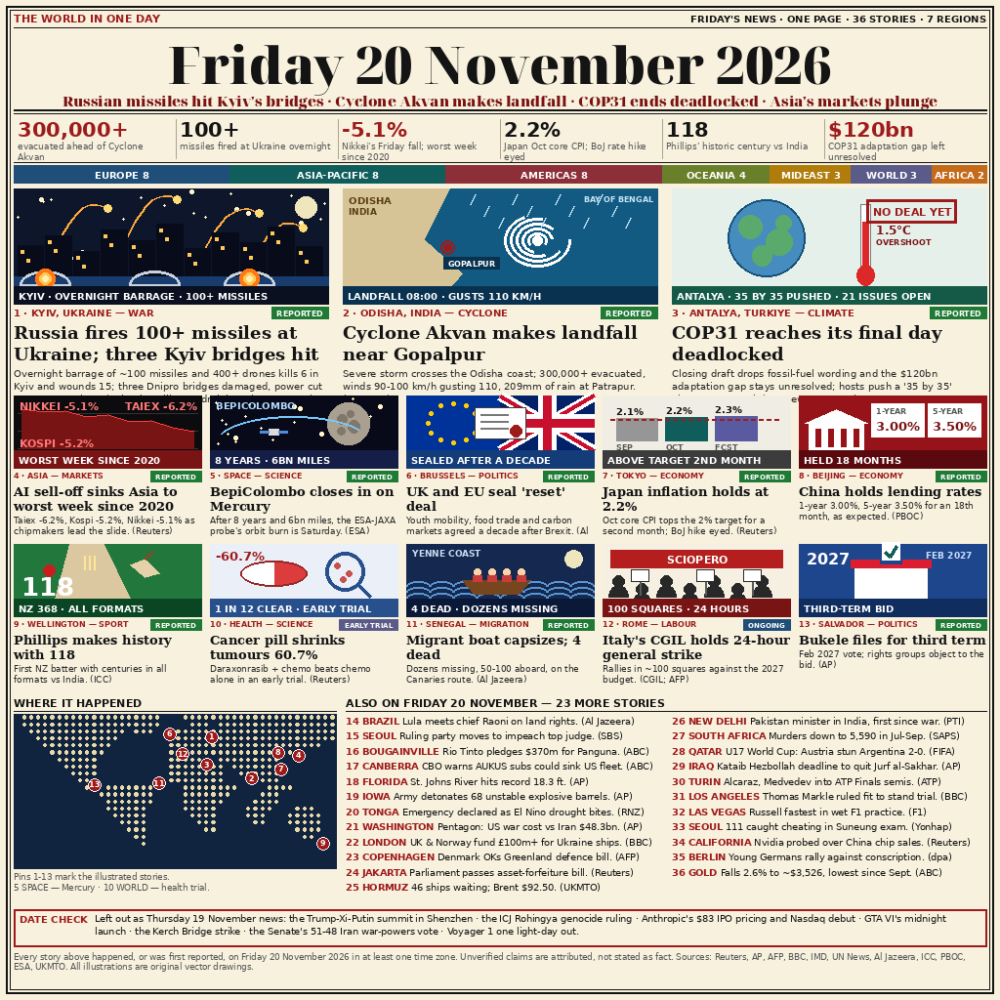

# Friday 20 November 2026 — The World in One Day (v3)

One-page broadsheet summing up the world's news of Friday 20 November 2026,
built for the [news-image-20261120 bounty](https://make.fun/bounty/news-image-20261120)
on make.fun.

## What's on the page

- **36 stories, 7 regions, 13 illustrated** — 3 lead stories (Kyiv missile
  barrage, Cyclone Akvan landfall, COP31 final-day deadlock) + 10 feature
  cards (Asia AI sell-off, BepiColombo at Mercury, UK–EU reset deal, Japan
  CPI, China rates, Phillips' 118, cancer pill, Senegal migrant boat, Italy
  general strike, Bukele's third-term bid) + 23 briefs.
- **Numbers strip** (300,000+ evacuated · 100+ missiles · Nikkei −5.1% ·
  Japan CPI 2.2% · Phillips 118 · COP31 $120bn gap), **region bar**,
  **dot-grid world map** with numbered pins for the illustrated stories, and a
  **DATE CHECK** footer excluding Thursday 19 November news.
- Every illustrated story carries a proof tag (REPORTED / ONGOING /
  EARLY TRIAL); claims are attributed to their sources, never stated as fact.

## How it works

- `render_v3.py` — the renderer (Python + Pillow). Draws the whole broadsheet
  from scratch: masthead, numbers, region bar, 13 original vector
  illustrations, map, briefs, DATE CHECK. Deterministic: no network, no
  randomness, no clock — re-running produces byte-identical output.
- `main.py` — the entrypoint. Copies the rendered `entry.png` to
  `/output/entry.png`.
- `entry.png` — the rendered broadsheet, 1024×1024.

Regenerate: `python3 render_v3.py entry.png`

## Sources

Reuters, AP, AFP, BBC, IMD, UN News, Al Jazeera, ICC, PBOC, ESA, UKMTO.
All illustrations are original vector drawings made for this entry.
